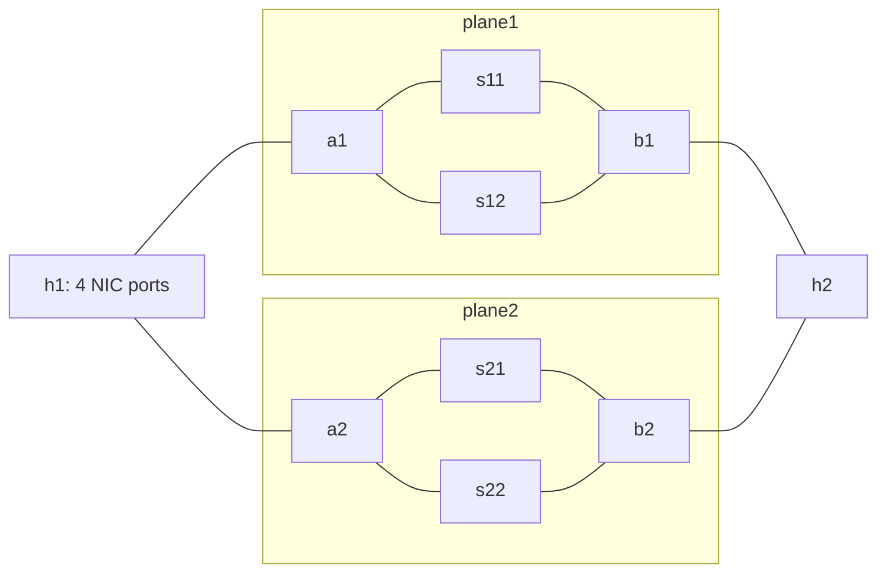

# clab-mrc

A containerlab learning lab that reproduces, at small scale, the network design
in the OpenAI/Microsoft paper
[*Resilient AI Supercomputer Networking using MRC and SRv6*][paper]
([OpenAI article][article], [OCP MRC 1.0 specification][spec]):

- a **multi-plane, two-tier Clos** fabric;
- **static SRv6 uSID source routing** with no routing protocol on the switches;
- endpoints running an **MRC-style transport** that sprays packets over many
  paths, retransmits selectively, and routes around failures by itself;

side by side with the conventional design it replaces: **eBGP + ECMP** with a
single-path, RoCE-style flow.

**This is an educational userspace implementation, not an interoperable MRC or
RDMA implementation.** The switches are real (Linux kernel SRv6, FRR); the
"NICs" are Python processes. Read
[what this lab is, how close it is to MRC, and what it proves](docs/how-close-to-mrc.md)
before drawing conclusions from the numbers. The code has not been reviewed
against the MRC specification by anyone outside this project.

## Start here (new to the repo)

Read in this order:

1. **This README**, down to "Results at a glance" (5 minutes). Open
   [docs/img/silent-link.svg](docs/img/silent-link.svg) in a browser.
2. [docs/how-close-to-mrc.md](docs/how-close-to-mrc.md): what is real, what
   is modelled, what it proves and does not.
3. [docs/walkthrough.md](docs/walkthrough.md): one section per paper claim, each
   with the command and the evidence. Sections 3-8 are the core.
4. [docs/evidence/.../README.md](docs/evidence/multi-plane-multi-link/README.md):
   every result table, with charts.
5. Code, if you want it: `mrc_paths.py` (92 lines, the uSID and EV maths), then
   `mrc_reliability.py`, then `transport.py` (the endpoint), then `lab.py`
   (topology generation and experiments).

Then play (needs Linux 6.1+, Docker, containerlab; see [Requirements](#quick-start); about 2 minutes to deploy):

```sh
make test                 # no lab needed
make up                   # both fabrics: baseline (BGP) and mrc
make demo                 # same silent link failure on both; compare the output
docker exec clab-mrc-multi-plane-multi-link-a1 vtysh -c "show ipv6 route bgp"  # baseline switch (BGP routes)
docker exec clab-mrc-multi-plane-multi-link-mrc-a1 ip -6 route                # mrc switch: static routes only
make experiment NAME=gray-switch FABRIC=baseline
make experiment NAME=gray-switch FABRIC=mrc
make experiment NAME=ecmp-collision FABRIC=baseline   # run it again: the hash is random per seed
make down
```

Things to try: change
the number of EVs in `mrc_sender_args()`; change the fault in the `FAULTS` table
(for example 5% loss instead of 20%); lower the BGP timers. After each
change, run `make test` and then an experiment.

## See it first

Animated replays of real runs (open the SVG in a browser; line thickness is
packets delivered on each path). Top: BGP + ECMP; bottom: MRC.

| Replay | File |
|---|---|
| Silent link failure | [docs/img/silent-link.svg](docs/img/silent-link.svg) |
| Spine drops traffic, control plane up | [docs/img/gray-switch.svg](docs/img/gray-switch.svg) |
| 20% loss on one link | [docs/img/partial-loss.svg](docs/img/partial-loss.svg) |
| Receiver loses a plane's NIC ports | [docs/img/nic-plane.svg](docs/img/nic-plane.svg) |
| ECMP flow collisions | [docs/img/ecmp-collision.svg](docs/img/ecmp-collision.svg) |





Each plane is an independent two-tier Clos. MRC sprays one flow over all four
spine paths; the baseline pins a flow to one path with a hash.

## What it demonstrates

| Paper claim | How the lab shows it | Evidence |
|---|---|---|
| Switches need no dynamic routing: one uN uSID plus static routes, set once | `mrc` fabric: `bgpd` disabled, `End` + `next-csid` routes and `staticd` routes only | [walkthrough §3](docs/walkthrough.md#3-static-srv6-usid-routing-instead-of-bgp) |
| IPv6-in-IPv6, outer destination = uSID path, each switch shifts it | pcaps at four hops of one packet | [§4](docs/walkthrough.md#4-packet-format-and-per-hop-shifting), [`spray/`](docs/evidence/multi-plane-multi-link/mrc/spray/) |
| EV in UDP source port + flow label, mapped algorithmically to the path | `mrc_paths.ev_address()`; pcap inner headers | [§4](docs/walkthrough.md#4-packet-format-and-per-hop-shifting) |
| One QP sprays over EVs split equally across planes | per-EV and per-plane packet counts | [§5](docs/walkthrough.md#5-spraying-over-an-ev-set) |
| SACK-based selective retransmission | `mrc_reliability` PSNs and binary SACKs on the wire | [§6](docs/walkthrough.md#6-reliability-psns-sacks-selective-retransmission) |
| First loss retires an EV, same-plane backup takes over, probes resurrect it | event logs of failure runs | [§7](docs/walkthrough.md#7-failure-handling-inside-the-endpoint) |
| Port-state bitmap in SACKs; reverse EV set | `nic-plane` event log | [§7](docs/walkthrough.md#7-failure-handling-inside-the-endpoint) |
| Rides out silent links and gray switch failures that routing cannot see | four faults on both fabrics, with control-plane monitoring | [§8](docs/walkthrough.md#8-mrc-versus-bgp--ecmp-under-failures), [results](docs/evidence/multi-plane-multi-link/README.md) |
| ECN is a load-balancing signal | two-flow experiment, with and without ECN avoidance | [§9](docs/walkthrough.md#9-ecn-as-a-load-balancing-signal) |
| Clustermapper localizes failures with source-routed self probes | probes to each T0/T1 and back | [§10](docs/walkthrough.md#10-clustermapper-source-routed-self-probes) |

## Results at a glance

Profile `multi-plane-multi-link`, 2,000 packets/s, fault injected 1 s into the
run. Full numbers, charts and raw files: [docs/evidence](docs/evidence/multi-plane-multi-link/README.md).

| Fault | Baseline: eBGP + ECMP, single-path flow | mrc: static uSID, MRC-style endpoint |
|---|---|---|
| T0-T1 link administratively down | no interruption (local ECMP repair) | no interruption; failed EVs retired after 21 ms |
| T0-T1 link silently drops everything | **no delivery for 2.27 s** (BGP hold timer) | no interruption; EVs retired after 24 ms, back 84 ms after repair |
| Spine stops forwarding, control plane up | **no delivery for 3.03 s, until repaired**; BGP stays up | no interruption; EVs retired after 18 ms, back 93 ms after repair |
| Receiver loses its plane-1 NIC ports | **no delivery for 1.99 s, until repaired** | no interruption; peer told via SACK port bitmap in 7 ms |
| One link drops 20% of packets | **515 pkt/s of 2,000**, degraded for the whole fault | 2,000 pkt/s; EVs retired after 2 ms |
| 4 flows, random ECMP hashes, 10 Mbit links | **mean 1,788 of 2,800 pkt/s**, worst flow 343 | 2,800 pkt/s, worst flow 700 (sprayed over all uplinks) |
| 0.1% / 1% random loss on every link | 0.3% / 4.6% of packets retransmitted | 0.1% / 1.0% retransmitted |
| BFD (100 ms x 3) added to the baseline | silent link 2.27 s -> 0.29 s; gray switch still ~3 s | not needed |
| Competing flow congests one spine uplink (ECN) | - | flow shifts 50/50 -> 35/65 away from the marked path, no loss |

For a clean local link failure both designs cope; the difference appears when
the data plane fails in a way the control plane cannot see. Read
[§8](docs/walkthrough.md#8-mrc-versus-bgp--ecmp-under-failures) for why, and
[§12](docs/walkthrough.md#12-fairness-decisions-and-lab-artefacts) for the
fairness decisions behind the comparison.

## Quick start

Requirements: **Linux 6.1 or later** for the MRC fabric (native SRv6 uSID; the BGP baseline does not need it), Docker,
[containerlab](https://containerlab.dev/), Python 3.9+, and root (or
equivalent) for containerlab. No host Python packages are needed. The image
extends `quay.io/frrouting/frr:10.5.0` with tcpdump. Tested on Debian 11 with
kernel 6.1.0-0.deb11.21-amd64, containerlab 0.73, FRR 10.5.

```sh
make test                                  # unit tests, no lab needed
make preflight                             # forwards a real packet through a uSID hop
make up                                    # deploy both fabrics
make demo                                  # silent-link on both fabrics + regenerate the SVG
make experiment NAME=gray-switch FABRIC=mrc
make down
```

`make` runs without sudo when your user may use Docker and containerlab; if not,
use `make up SUDO=sudo`. `make` alone lists every target. The underlying
commands are plain `python3 lab.py <action> [name] --fabric baseline|mrc`:

```sh
python3 lab.py deploy --fabric mrc          # default profile: multi-plane-multi-link
python3 lab.py test --fabric mrc            # control plane, spraying, a link failure + repair
python3 lab.py experiment gray-switch --fabric mrc
python3 lab.py destroy --fabric mrc
```

Both fabrics of the same profile can run at the same time (separate lab names
and management subnets). Experiments: `spray`, `link-down`, `silent-link`,
`partial-loss`, `gray-switch`, `nic-plane`, `ecmp-collision`, `random-loss`,
`ecn`, `clustermap` (`spray`, `ecn` and `clustermap` need `--fabric mrc`;
`nic-plane` needs two planes), plus `silent-link-bfd` and `gray-switch-bfd`
(baseline only: the same faults with BFD on every eBGP session). `evidence` runs every
experiment and copies results into `docs/evidence/`; `report` regenerates the
evidence README from those files.

| Action | What it does |
|---|---|
| `generate` | Write `topologies/<lab>/` (containerlab file, FRR configs, `fabric.json`, README) |
| `preflight` | Check tools and kernel SRv6 support in a throwaway container |
| `deploy` | `generate`, build the image, `preflight`, `containerlab deploy`, `configure` |
| `configure` | Install host addresses/routes and uSID `End` routes; verify reachability |
| `test` | Control-plane checks plus `spray` (mrc) and `link-down` with pass/fail criteria |
| `experiment <name>` | Run one experiment (or `all`) |
| `evidence [name]` | Run experiments and copy summaries, raw JSON and pcaps into `docs/evidence/` |
| `summarize`, `report` | Recompute summaries from raw files; regenerate the evidence README |
| `destroy` | `containerlab destroy` |

## Fabrics

| | `baseline` | `mrc` |
|---|---|---|
| Switch control plane | FRR eBGP (timers 1/3), `maximum-paths 8` | none (`bgpd` off); FRR `staticd` routes to neighbour uSIDs |
| Forwarding | ECMP, 5-tuple hash | SRv6 uN uSID: `End` + `next-csid`, block `fcbb:0::/32`, 16-bit uSIDs |
| Packets | plain IPv6/UDP to the peer NIC address | IPv6-in-IPv6: outer = uSID path, inner = NIC to NIC (UDP 4791) |
| EV | UDP source port, hashed by switches | encodes plane, NIC port and spine; path rebuilt from it |
| Endpoint | `--algo roce`: one path, go-back-N | `--algo mrc`: EV set, SACK, retire/probe/resurrect, ECN, port bitmap |

The endpoint ([transport.py](transport.py)) supports both algorithms on both
fabrics (`--algo mrc` over ECMP sprays by source port, as MRC can without
SRv6), but the comparison uses each fabric with its natural endpoint.

## Topologies

| Profile | Planes | NIC ports per plane | Containers | Links | Paths h1 -> h2 |
|---|---:|---:|---:|---:|---:|
| `single-plane-single-link` | 1 | 1 | 6 | 6 | 2 |
| `single-plane-multi-link` | 1 | 2 | 6 | 8 | 4 |
| `multi-plane-single-link` | 2 | 1 | 10 | 12 | 4 |
| `multi-plane-multi-link` (default) | 2 | 2 | 10 | 16 | 8 |

Each plane has leaf `aN` (h1 side, T0), leaf `bN` (h2 side, T0) and spines
`sN1`/`sN2` (T1). Hosts are shared by all planes; switches are not. Generated
files are under `topologies/<profile>/` (baseline) and
`topologies/<profile>-mrc/`, each with a port-level diagram and, for `mrc`, the
uSID and path tables (committed for the default profile only; the others are
regenerated by `make up`). Management subnets: `172.31.250-253.0/24` (baseline) and
`172.31.240-243.0/24` (mrc).

## Repository layout

| Path | Contents |
|---|---|
| [lab.py](lab.py) | Topology generation, deploy/configure, preflight, fault injection, experiments, evidence and report |
| [transport.py](transport.py) | Userspace MRC-style endpoint ("NIC"): sender, responder, Clustermapper |
| [mrc_paths.py](mrc_paths.py) | uSID allocation and the algorithmic EV-to-path mapping |
| [mrc_reliability.py](mrc_reliability.py) | 24-bit PSNs, receiver/requestor state, SETH + CC_STATE SACK codec ([notes](docs/reliability.md)) |
| [docs/how-close-to-mrc.md](docs/how-close-to-mrc.md) | What is real, what is modelled, what it proves |
| [docs/walkthrough.md](docs/walkthrough.md) | Paper claim -> mechanism -> command -> evidence |
| [docs/evidence/](docs/evidence/multi-plane-multi-link/README.md) | Reference results: summaries, raw sender/receiver JSON, pcaps and decodes |
| `test_*.py` | Unit tests (addressing, path walks, endpoint state machine, codecs) |

## Notes

- Containers share the host kernel; the lab changes network sysctls only inside
  its containers. Do not run untrusted workloads in it.
- Do not `deploy` over a running lab; `configure` reapplies host state, or
  destroy and redeploy. Container restarts do not reapply it.
- `results/` directories are not version controlled; `docs/evidence/` is the
  curated copy.

## References

- [Resilient AI Supercomputer Networking using MRC and SRv6][paper] (OpenAI, Microsoft, AMD, Broadcom, NVIDIA)
- [OpenAI: MRC supercomputer networking][article]
- [OCP MRC 1.0 specification][spec]
- [RFC 9800: compressed SRv6 segment lists (NEXT-C-SID)](https://www.rfc-editor.org/rfc/rfc9800)
- [Devang Patel's containerlab article][linkedin], which motivated the lab
- [containerlab](https://containerlab.dev/), [FRR 10.5 documentation](https://docs.frrouting.org/en/stable-10.5/)

[paper]: https://cdn.openai.com/pdf/resilient-ai-supercomputer-networking-using-mrc-and-srv6.pdf
[article]: https://openai.com/index/mrc-supercomputer-networking/
[spec]: https://www.opencompute.org/documents/ocp-mrc-1-0-pdf/
[linkedin]: https://www.linkedin.com/pulse/container-lab-based-topologies-learning-mrc-devang-patel-fpirc/
