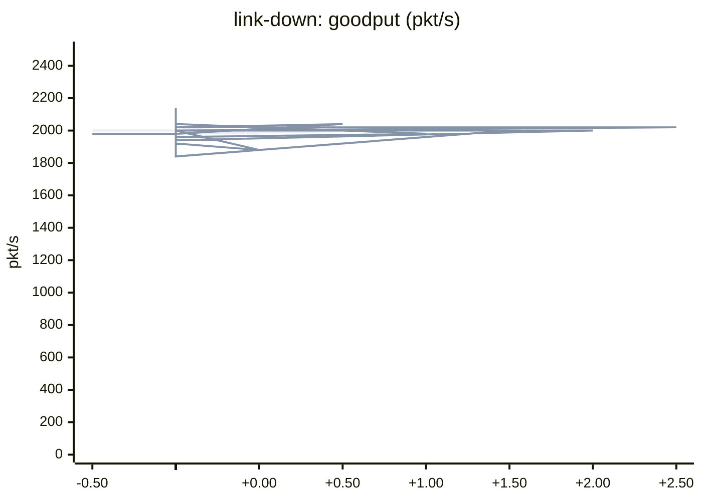
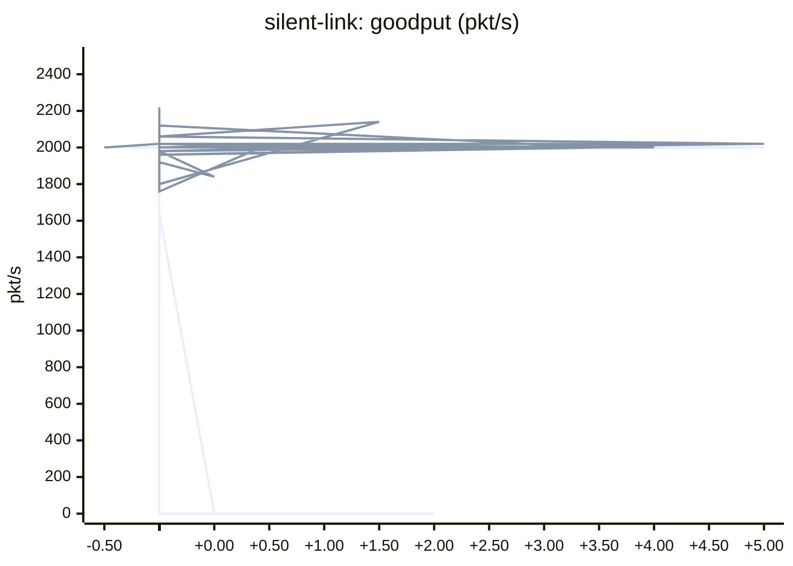
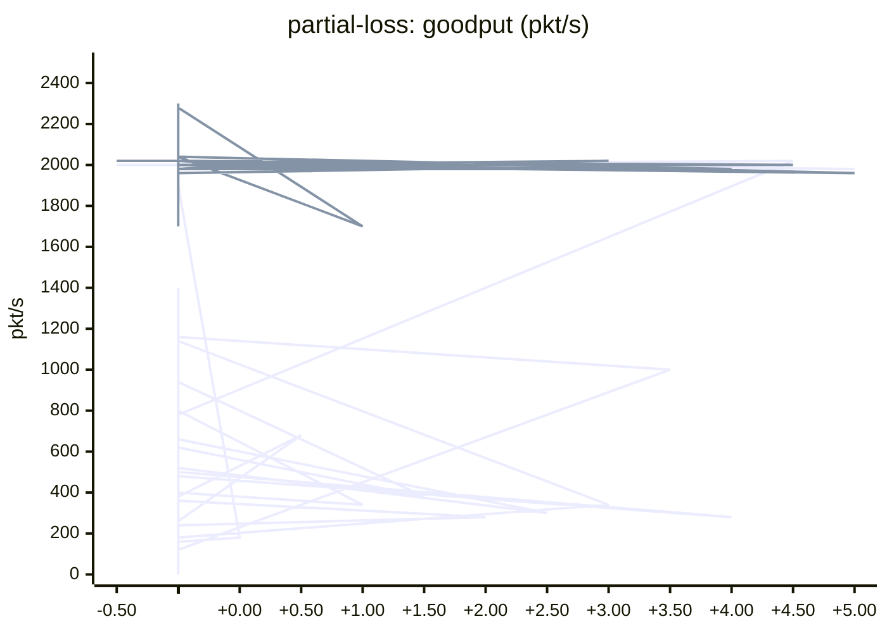
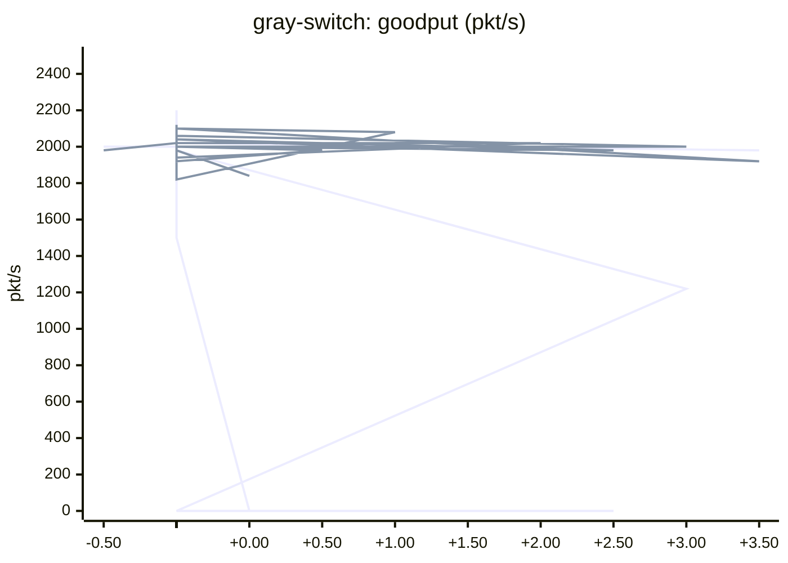
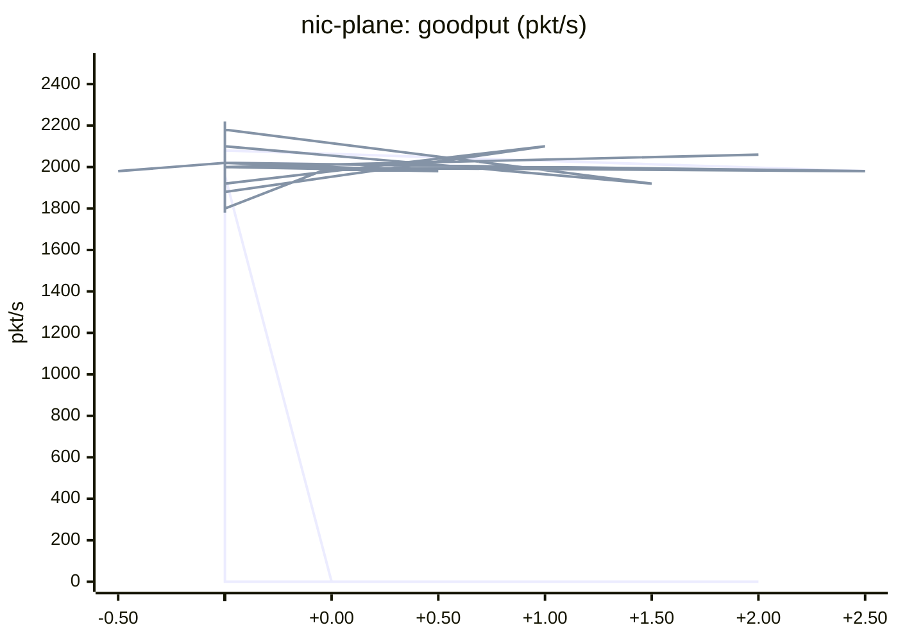

# Evidence: multi-plane-multi-link

Generated by `python3 lab.py report` from the files in this directory (see [the walkthrough](../../walkthrough.md) for how to read them). Kernel `6.1.0-0.deb11.21-amd64`, collected 2026-10-31.

Every fault run sends 2,000 packets/s for several seconds; the fault is injected 1 s in. Baseline traffic is one RoCE-style single-path QP (go-back-N) whose ECMP hash was chosen to cross the fault; mrc traffic is one MRC-style QP spraying over its EV set.

| Experiment | Fault | Baseline (eBGP + ECMP, single path) | mrc (static SRv6 uSID, MRC endpoint) |
|---|---|---|---|
| `link-down` | T0-T1 link a1-s11 administratively down, then up | **2000 pkt/s** during the fault; no interruption; 0 packets retransmitted | **1991 pkt/s** during the fault; no interruption; 12 packets retransmitted; failed EVs removed 21 ms after the fault, back in use 82 ms after the repair |
| `silent-link` | T0-T1 link a1-s11 drops everything (carrier stays up) | **986 pkt/s** during the fault; **nothing delivered for 2270 ms**, then recovered; 4562 packets retransmitted | **1999 pkt/s** during the fault; no interruption; 13 packets retransmitted; failed EVs removed 24 ms after the fault, back in use 84 ms after the repair |
| `partial-loss` | T0-T1 link a1-s11 drops 20% of packets in both directions | **515 pkt/s** during the fault; **degraded**, never fully stopped (longest gap 80 ms); 6686 packets retransmitted | **2000 pkt/s** during the fault; no interruption; 1 packets retransmitted; failed EVs removed 2 ms after the fault |
| `gray-switch` | Spine s11 stops forwarding data; its control plane stays up | **0 pkt/s** during the fault; **nothing delivered for 3030 ms**, until the repair; 6065 packets retransmitted | **1999 pkt/s** during the fault; no interruption; 12 packets retransmitted; failed EVs removed 18 ms after the fault, back in use 93 ms after the repair |
| `nic-plane` | h2 loses its plane-1 NIC port(s) (links to b1 down), then they recover | **9 pkt/s** during the fault; **nothing delivered for 1990 ms**, until the repair; 4336 packets retransmitted | **1993 pkt/s** during the fault; no interruption; 9 packets retransmitted; failed EVs removed 7 ms after the fault, back in use 53 ms after the repair |

## Spraying and uSID forwarding (`spray`, mrc)

One QP sent 2001 packets: per EV `10111` 254, `10112` 250, `10121` 252, `10122` 248, `10211` 249, `10212` 251, `10221` 247, `10222` 250; per plane plane 1: 1004, plane 2: 997. Outer destination of the EV `10111` packets at each capture point (`mrc/spray/*.txt`):

| Capture point | Outer IPv6 destination | Seen |
|---|---|---|
| h1-port1 | `fcbb:0:a101:5110:b101:e211::` | yes |
| s11-ingress | `fcbb:0:5110:b101:e211::` | yes |
| b1-to-h2 | `fcbb:0:e211::` | yes |
| h2-ingress | `fcbb:0:e211::` | yes |

## ECN as a load-balancing signal (`ecn`, mrc)

Both a1 uplinks are shaped to 20 Mbit/s with RED ECN marking. Flow A (2,400 pkt/s, EVs via s11 and s12) runs for 6 s; flow B (1,400 pkt/s, pinned to the s11 path) joins after 2 s for 2.5 s.

| Variant | Flow A share via s11: before / with B / after | a1->s11 queue | Flow B goodput (offered 1,400) | False loss declarations A / B |
|---|---|---|---|---|
| ecn-avoid | 50% / 35% / 50% | 805 marked, 0 dropped | 1400 pkt/s | 0 / 0 |
| no-ecn-avoid | 50% / 36% / 50% | 3355 marked, 0 dropped | 1240 pkt/s | 28 / 312 |

## Clustermapper self-probes (`clustermap`, mrc)

| Target | Probe address (to the switch and back to h1) | Healthy | a1-s11 silently failed |
|---|---|---|---|
| T0 a1 via port 1 | `fcbb:0:a101:e111::` | 20/20 | 20/20 |
| T1 s11 via port 1 | `fcbb:0:a101:5110:a101:e111::` | 20/20 | 0/20 |
| T1 s12 via port 1 | `fcbb:0:a101:5120:a101:e111::` | 20/20 | 20/20 |
| T0 a1 via port 2 | `fcbb:0:a102:e112::` | 20/20 | 20/20 |
| T1 s11 via port 2 | `fcbb:0:a102:5110:a102:e112::` | 20/20 | 0/20 |
| T1 s12 via port 2 | `fcbb:0:a102:5120:a102:e112::` | 20/20 | 20/20 |
| T0 a2 via port 1 | `fcbb:0:a201:e121::` | 20/20 | 20/20 |
| T1 s21 via port 1 | `fcbb:0:a201:5210:a201:e121::` | 20/20 | 20/20 |
| T1 s22 via port 1 | `fcbb:0:a201:5220:a201:e121::` | 20/20 | 20/20 |
| T0 a2 via port 2 | `fcbb:0:a202:e122::` | 20/20 | 20/20 |
| T1 s21 via port 2 | `fcbb:0:a202:5210:a202:e122::` | 20/20 | 20/20 |
| T1 s22 via port 2 | `fcbb:0:a202:5220:a202:e122::` | 20/20 | 20/20 |

Diagnosis: T0-T1 link a1-s11 (or spine s11) is bad

## Does BFD fix the baseline? (`silent-link-bfd`, `gray-switch-bfd`)

BGP timers here are already 1 s keepalive / 3 s hold (real defaults are 60/180 s). The BFD runs use 100 ms x 3 on every eBGP session.

| Fault | Longest outage, BGP timers only | Longest outage, BGP + BFD |
|---|---|---|
| `silent-link` | 2270 ms | 290 ms |
| `gray-switch` | 3030 ms | 3000 ms (until repair) |

BFD only helps where a link-level hello is lost. A spine that keeps answering BFD while dropping transit traffic is invisible to it.

## ECMP flow collisions (`ecmp-collision`)

4 flows of 700 pkt/s (offered 2800) cross links limited to 10 Mbit/s. Baseline flows get random UDP source ports (ECMP hash); mrc flows spray over all paths. Three random seeds each.

| Fabric | Seed | Uplinks used | Aggregate pkt/s | Worst flow pkt/s | Retransmissions |
|---|---|---|---|---|---|
| baseline | 1 | 3/4 | 1781 | 177 | 6118 |
| baseline | 2 | 2/4 | 784 | 152 | 12094 |
| baseline | 3 | 4/4 | 2800 | 700 | 0 |
| mrc | 1 | 4/4 | 2800 | 700 | 6 |
| mrc | 2 | 4/4 | 2800 | 700 | 4 |
| mrc | 3 | 4/4 | 2800 | 700 | 7 |

Mean aggregate: baseline 1788, mrc 2800 pkt/s. Mean worst flow: baseline 343, mrc 700 pkt/s.

## Random loss on every link (`random-loss`)

Uniform netem loss on all leaf-to-spine links, 4,000 pkt/s offered. At this scale RoCE-style recovery does not collapse; the visible cost is retransmission amplification (go-back-N resends the window after each loss).

| Loss | Baseline | mrc |
|---|---|---|
| 0% | 3998 pkt/s, 0.0% retransmitted | 3996 pkt/s, 0.0% retransmitted |
| 0.1% | 3983 pkt/s, 0.3% retransmitted | 3986 pkt/s, 0.1% retransmitted |
| 1.0% | 3821 pkt/s, 4.6% retransmitted | 3954 pkt/s, 1.0% retransmitted |

## Goodput around each fault

### `link-down`

T0-T1 link a1-s11 administratively down, then up. Fault at 0 s, repair at 2.0 s. Delivered packets per second in 50 ms buckets (first line: baseline, second line: mrc).

### `silent-link`

T0-T1 link a1-s11 drops everything (carrier stays up). Fault at 0 s, repair at 4.5 s. Delivered packets per second in 50 ms buckets (first line: baseline, second line: mrc).

### `partial-loss`

T0-T1 link a1-s11 drops 20% of packets in both directions. Fault at 0 s, repair at 4.5 s. Delivered packets per second in 50 ms buckets (first line: baseline, second line: mrc).

### `gray-switch`

Spine s11 stops forwarding data; its control plane stays up. Fault at 0 s, repair at 3.0 s. Delivered packets per second in 50 ms buckets (first line: baseline, second line: mrc).

### `nic-plane`

h2 loses its plane-1 NIC port(s) (links to b1 down), then they recover. Fault at 0 s, repair at 2.0 s. Delivered packets per second in 50 ms buckets (first line: baseline, second line: mrc).

