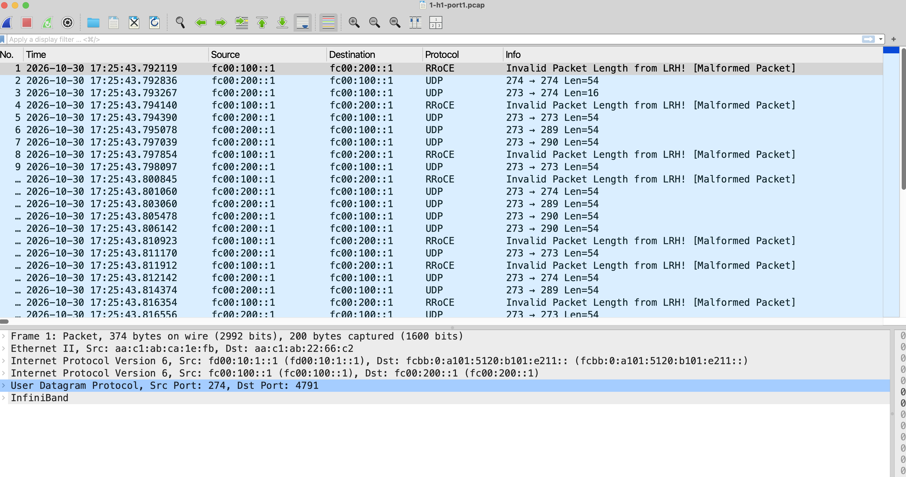

# Understanding the Evidence Files

This guide helps you interpret the PCAP files and JSON data in `docs/evidence/`.
It explains the packet structure, EV encoding, and how to read captures in Wireshark.

## Quick Reference

### Packet Structure (IPv6-in-IPv6 Encapsulation)

MRC packets use **two IPv6 headers**:

```
┌─────────────────────────────────────────────────────────────────────────┐
│ Ethernet II                                                             │
│   Src: aa:c1:ab:ca:1e:fb    Dst: aa:c1:ab:22:66:c2                     │
├─────────────────────────────────────────────────────────────────────────┤
│ Outer IPv6 Header (SRv6 path)                                           │
│   Src: fd00:10:1::1         Dst: fcbb:0:a101:5120:b101:e211::          │
│                                   └─────────────────────────┘           │
│                                          uSID segment list              │
├─────────────────────────────────────────────────────────────────────────┤
│ Inner IPv6 Header (endpoint addresses)                                  │
│   Src: fc00:100::1 (h1)     Dst: fc00:200::1 (h2)                      │
├─────────────────────────────────────────────────────────────────────────┤
│ UDP Header                                                              │
│   Src Port: 274 (EV)        Dst Port: 4791 (RRoCE/MRC port)            │
├─────────────────────────────────────────────────────────────────────────┤
│ MRC Payload (PSN, SACK, data)                                           │
└─────────────────────────────────────────────────────────────────────────┘
```

### Key Fields

| Field | Location | Example | What It Means |
|-------|----------|---------|---------------|
| **EV** | UDP source port | `274` | Enumerated Value — identifies the path |
| **uSID** | Outer IPv6 destination | `fcbb:0:a101:5120:b101:e211::` | Full segment list encoding the path |
| **MRC port** | UDP destination port | `4791` | Fixed RRoCE/RDMA port (always 4791) |
| **Inner source** | Inner IPv6 source | `fc00:100::1` | Sender's NIC address (h1) |
| **Inner dest** | Inner IPv6 destination | `fc00:200::1` | Receiver's NIC address (h2) |

---

## EV Encoding

The **EV (Enumerated Value)** is a compact encoding of the path choices:

```
EV = (salt << 16) | (plane << 8) | (link << 4) | spine
```

### Decoding an EV

To decode an EV like `274`:

1. Convert to hex: `274` = `0x0112`
2. Extract fields:
   - `plane` = `(0x0112 >> 8) & 0xF` = `1`
   - `link` = `(0x0112 >> 4) & 0xF` = `1`
   - `spine` = `0x0112 & 0xF` = `2`
3. Result: plane 1, link 1, spine 2 → uses **spine s12**

### EV Reference Table (multi-plane-multi-link)

| EV (decimal) | EV (hex) | Plane | Link | Spine | h1 Port | Path (Spine) |
|--------------|----------|-------|------|-------|---------|--------------|
| 273 | `0x0111` | 1 | 1 | 1 | eth1 | s11 |
| 274 | `0x0112` | 1 | 1 | 2 | eth1 | s12 |
| 289 | `0x0121` | 1 | 2 | 1 | eth2 | s11 |
| 290 | `0x0122` | 1 | 2 | 2 | eth2 | s12 |
| 529 | `0x0211` | 2 | 1 | 1 | eth3 | s21 |
| 530 | `0x0212` | 2 | 1 | 2 | eth3 | s22 |
| 545 | `0x0221` | 2 | 2 | 1 | eth4 | s21 |
| 546 | `0x0222` | 2 | 2 | 2 | eth4 | s22 |

---

## uSID Encoding

The **uSID** (Micro-SID) encodes the full path as a sequence of 16-bit segments:

```
fcbb:0:a101:5120:b101:e211::
       │    │    │    │
       │    │    │    └── e211: host endpoint (h2, plane 1, link 1)
       │    │    └─────── b101: leaf b1 (receiver side, plane 1, port 1)
       │    └──────────── 5120: spine s12 (plane 1, spine 2)
       └───────────────── a101: leaf a1 (sender side, plane 1, port 1)
```

### uSID Segment Format

| Segment | Format | Example | Meaning |
|---------|--------|---------|---------|
| Leaf (sender) | `0xA<plane>0<link>` | `a101` | Leaf a1, port 1 |
| Spine | `0x5<plane><spine>0` | `5120` | Spine s12 (plane 1, spine 2) |
| Leaf (receiver) | `0xB<plane>0<link>` | `b101` | Leaf b1, port 1 |
| Host endpoint | `0xE<host><plane><link>` | `e211` | h2, plane 1, link 1 |

---

## Reading the `spray` Experiment PCAPs

The `spray/` directory contains 4 PCAPs showing one packet's journey:

| File | Capture Point | What It Shows |
|------|---------------|---------------|
| `1-h1-port1.pcap` | Sender (h1 port 1) | Packets leaving the sender |
| `2-s11-ingress.pcap` | Spine s11 ingress | Packets entering the first spine |
| `3-b1-to-h2.pcap` | Leaf b1 → h2 | Packets reaching the receiver's leaf |
| `4-h2-ingress.pcap` | Receiver (h2) ingress | Packets arriving at the receiver |

### What You'll See in Wireshark

Opening `1-h1-port1.pcap`:




**Understanding the rows:**

| Protocol | Direction | What It Is |
|----------|-----------|------------|
| **RRoCE** | `fc00:100::1 → fc00:200::1` | Data packet (h1 → h2), port 4791 |
| **UDP** | `fc00:200::1 → fc00:100::1` | ACK/SACK packet (h2 → h1) |

**Why "Invalid Packet Length from LRH!"?**
- Wireshark recognizes port 4791 as RRoCE/RDMA and tries to parse InfiniBand headers
- MRC uses a custom format, not true InfiniBand
- The data is valid — Wireshark just can't decode the MRC payload
- **This is expected behavior**, not an error

### Viewing Packet Details

Select packet #1 and expand the headers:

```
Frame 1: Packet, 374 bytes on wire
> Ethernet II, Src: aa:c1:ab:ca:1e:fb, Dst: aa:c1:ab:22:66:c2
> Internet Protocol Version 6, Src: fd00:10:1::1, Dst: fcbb:0:a101:5120:b101:e211::
> Internet Protocol Version 6, Src: fc00:100::1, Dst: fc00:200::1
> User Datagram Protocol, Src Port: 274, Dst Port: 4791
> InfiniBand
```

From this you can read:
- **Outer dest** (`fcbb:0:a101:5120:b101:e211::`) → uSID path through spine s12
- **Inner src/dst** (`fc00:100::1` → `fc00:200::1`) → h1 to h2
- **UDP src port** (`274`) → EV = plane 1, link 1, spine 2

---

## Spraying Pattern

In the `spray` experiment, you'll see packets **alternating between EVs**:

```
Packet 1: EV 274 → fcbb:0:a101:5120:b101:e211:: (spine s12)
Packet 4: EV 273 → fcbb:0:a101:5110:b101:e211:: (spine s11)
Packet 8: EV 274 → fcbb:0:a101:5120:b101:e211:: (spine s12)
...
```

This proves **spraying** — the sender distributes packets across all available paths.

### How EVs Are Chosen

1. **Topology defines** the possible combinations: 2 planes × 2 links × 2 spines = 8 paths
2. **`ev_set()` function** generates all 8 EVs algorithmically
3. **Sender uses `--active-per-plane 2`** → keeps 2 EVs active per plane
4. **For h1 port 1** (plane 1, link 1): only EVs 273 and 274 apply

---

## Evidence Directory Structure

```
docs/evidence/multi-plane-multi-link/
├── mrc/
│   ├── spray/
│   │   ├── 1-h1-port1.pcap      # Sender-side capture
│   │   ├── 1-h1-port1.txt       # Decoded packets (text)
│   │   ├── 2-s11-ingress.pcap   # Spine ingress capture
│   │   ├── 2-s11-ingress.txt
│   │   ├── 3-b1-to-h2.pcap      # Leaf-to-receiver capture
│   │   ├── 3-b1-to-h2.txt
│   │   ├── 4-h2-ingress.pcap    # Receiver-side capture
│   │   ├── 4-h2-ingress.txt
│   │   ├── sender.json          # Sender's view (packets sent, losses)
│   │   ├── receiver.json        # Receiver's view (packets received)
│   │   └── summary.json         # Experiment summary
│   ├── silent-link/
│   ├── gray-switch/
│   └── ...
└── baseline/
    └── ...
```

### JSON File Contents

**`sender.json`**: Sender's statistics
- `sent_new`: Total new packets sent
- `delivered`: Packets acknowledged
- `losses`: Packets lost
- `evs`: Per-EV statistics (sent, acked, lost, state changes)
- `events`: Timestamped event log (EV retirements, activations, probes)

**`receiver.json`**: Receiver's statistics
- `received`: Total packets received
- `duplicates`: Duplicate packets
- `out_of_order`: Out-of-order arrivals

**`summary.json`**: High-level experiment results
- Fault timing
- Recovery metrics (first EV retired, time to restore)
- Goodput during fault

---

## Failure Experiments

In failure experiments (e.g., `silent-link`, `gray-switch`), you'll see:

1. **Before fault**: Normal spraying (EVs 273, 274 alternating)
2. **During fault**: One EV stops receiving ACKs → gets **retired**
3. **After fault**: Backup EV takes over, failed EV is **probed**
4. **Recovery**: Probes succeed → EV is **resurrected**

Look for these events in `sender.json`:
```json
{"t": 1730389543.792, "event": "ev_state", "ev": "111", "old": "ACTIVE", "new": "ASSUMED_BAD"}
{"t": 1730389543.812, "event": "ev_activated", "ev": "112", "plane": 1}
{"t": 1730389546.892, "event": "ev_resurrected", "ev": "111"}
```

---

## SACK (Selective Acknowledgment) Packets

SACK packets are **return traffic** from the receiver (h2 → h1) that tell the sender what was received.

### SACK Packet Structure (36 bytes)

```
Bytes  Field             Size   What It Means
──────────────────────────────────────────────────────────────────
0-1    Flags + M         2B     M = packet multiplier (0-2), PR = probe response
2-3    Ack PSN Offset    2B     Offset from cack_psn to the ACK'd PSN
4-7    Entropy           4B     EV of the packet being ACKed
8-9    SPDCID            2B     Sender port descriptor (flow ID)
10-11  DPDCID            2B     Destination port descriptor
12-15  CACK PSN          3B+1B  Current ACK PSN (base for calculations)
16-17  Reserved + MPR    2B     MPR = multipath refresh flag
18-19  SACK Offset       2B     Offset to SACK bitmap base
20-27  SACK Bitmap       8B     Bitmap of 64 PSNs (which were received)
28-35  CC_STATE          8B     Congestion control state (ECN, RTT)
```

### Finding SACK in Your PCAP

**Option 1: Using `pcap_decode.py` (Python)**

```bash
# Decode a specific PCAP
python3 src/pcap_decode.py docs/evidence/multi-plane-multi-link/mrc/spray/1-h1-port1.pcap | grep -A 20 "SACK"
```

**Option 2: Extract Raw Bytes (tcpdump)**

```bash
# Show packet #2 (usually an ACK/SACK packet in spray experiment)
tcpdump -r 1-h1-port1.pcap -X -c 2 | tail -20
```

This shows you the **raw hex dump**. The SACK is **36 bytes after the UDP header**.

**Option 3: Parse with tshark**

Since Wireshark doesn't have a built-in MRC dissector, you'll need to manually examine the UDP payload:

```bash
# Show packet hex for packet #2
tshark -r 1-h1-port1.pcap -Y "frame.number == 2" -x
```

### Example SACK Hex Dump

From your `spray/1-h1-port1.pcap`, a typical SACK packet (h2 → h1) might look like:

```
0x0000:  00 0e 00 01 00 00 01 11 00 01 00 01 00 ff ff 00
         └─┬─┘ └─────┬────┘ └──────┬──────┘ └──┬──┘
          flags   ack_psn entropy/EV    spdcid
        
0x0010:  00 00 00 ff 80 00 00 00 00 00 00 01 00 00 00 00
         └──────┬────┘ └────┬────┘ └─────────┬──────────┘
         cack_psn        sack_bitmap      cc_state
```

### Decoding the SACK

Breaking down the hex:
- `00 0e` → Flags (M=0, PR=0, reserved bits)
- `00 01` → Ack PSN Offset = 1 (ACKing PSN = cack_psn + 1)
- `00 00 01 11` → Entropy = 0x00000111 = **EV 273** (packet with this EV is being ACKed)
- `00 01` → SPDCID (sender port descriptor)
- `00 01` → DPDCID (destination port descriptor)
- `00 ff ff 00` → CACK PSN = 0x00ffff (current ACK PSN base)
- `00 00` → Reserved + MPR flag
- `00 00` → SACK Offset = 0
- `00 00 00 00 00 00 00 01` → SACK Bitmap = 0x0000000000000001
  - **This means**: PSN at `sack_base + 0` was received (bit 0 = 1), rest were not
- `00 00 00 00 00 00 00 00` → CC_STATE (congestion info, RTT estimate)

### What SACK Tells You

| Field | Example | Meaning |
|-------|---------|---------|
| **Entropy (EV)** | `0x0111` = 273 | This SACK is for packets sent on EV 273 (spine s11 path) |
| **SACK Bitmap** | `0x0000000000000001` | Only the first PSN in the range was received |
| **SACK Offset** | `0` | SACK bitmap starts at PSN = cack_psn + sack_offset |
| **Ack PSN Offset** | `1` | The highest ACKed PSN = cack_psn + 1 |
| **CC_STATE** | ECN bits, RTT | Congestion signals and round-trip time |

### Seeing SACK in Action (Failure Scenarios)

In failure experiments like `silent-link`, the SACK bitmap changes:

**Normal (no loss)**:
```
SACK Bitmap = 0xFFFFFFFFFFFFFFFF  (all 64 PSNs received)
```

**During loss** (e.g., link drops packets 5-8):
```
SACK Bitmap = 0x00000000000000DF  (binary: 1101 1111 = PSN 0-3,6-7 received)
                                                   └─ PSN 4-5 missing
```

The sender sees this and **only retransmits PSN 4-5**, not the whole flow.

---

## Quick Decode Commands

```bash
# Show all EVs and destinations in a PCAP
tshark -r 1-h1-port1.pcap -Y ipv6 -T fields -e ipv6.dst -e udp.srcport | head -20

# Count packets per EV
tshark -r 1-h1-port1.pcap -Y "udp.srcport" -T fields -e udp.srcport | sort | uniq -c

# Show full packet details (including hex)
tshark -r 1-h1-port1.pcap -Y "frame.number == 1" -V

# Extract SACK packets (h2 → h1, reverse direction)
tshark -r 1-h1-port1.pcap -Y "ipv6.src == fc00:200::1" -c 5

# Dump raw bytes of a packet (to see SACK manually)
tcpdump -r 1-h1-port1.pcap -X -c 1
```

### Using `pcap_decode.py`

If you have Scapy installed:
```bash
pip install scapy
python3 src/pcap_decode.py docs/evidence/multi-plane-multi-link/mrc/spray/1-h1-port1.pcap
```

This shows you:
- MRC header (opcode, flags, QP, PSN, EV)
- SACK fields decoded (entropy, ack_psn, sack_bitmap, cc_state)
- Per-packet analysis

---

## See Also

- [How close to MRC](how-close-to-mrc.md) — What this lab implements vs. real MRC
- [Walkthrough](walkthrough.md) — Paper claims with evidence
- [Reliability notes](reliability.md) — SACK codec and PSN handling (OCP MRC spec reference)
- [mrc_paths.py](../src/mrc_paths.py) — EV and uSID generation code
- [mrc_reliability.py](../src/mrc_reliability.py) — SACK and PSN implementation
- [transport.py](../src/transport.py) — MRC endpoint with SACK handling
