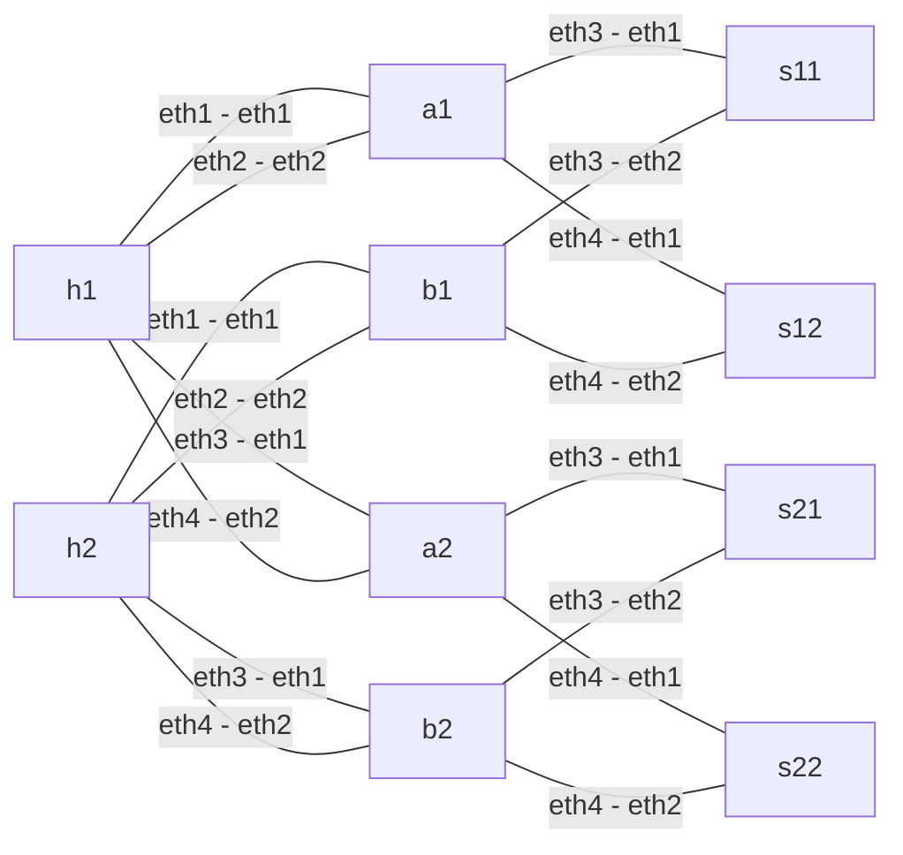

# multi-plane-multi-link-mrc

2 plane(s), 2 NIC port(s) per plane, 10 containers, 16 links, 8 distinct h1 -> h2 paths.

Each plane has leaf `aN` (h1 side), leaf `bN` (h2 side), and spines `sN1`/`sN2`. Hosts are shared across planes; switches are not.



Fabric `mrc`: no routing protocol. Every switch holds one uN uSID per role (`End` + `next-csid`, block `fcbb:0::/32`, 16-bit uSIDs) and static `/48` routes to its neighbours' uSIDs. Endpoints send IPv6-in-IPv6: the outer destination is the path and every switch shifts it; the inner destination is the NIC address.

| Node | uSIDs |
|---|---|
| h1 | `e111`, `e112`, `e121`, `e122` |
| h2 | `e211`, `e212`, `e221`, `e222` |
| a1 | `a101`, `a102` |
| b1 | `b101`, `b102` |
| s11 | `5110` |
| s12 | `5120` |
| a2 | `a201`, `a202` |
| b2 | `b201`, `b202` |
| s21 | `5210` |
| s22 | `5220` |

| EV (low bits) | Plane | h1 port | Spine | h1 -> h2 outer destination | h2 -> h1 (same plane/port/spine) |
|---|---:|---|---|---|---|
| `0111` | 1 | eth1 | s11 | `fcbb:0:a101:5110:b101:e211::` | `fcbb:0:b101:5110:a101:e111::` |
| `0112` | 1 | eth1 | s12 | `fcbb:0:a101:5120:b101:e211::` | `fcbb:0:b101:5120:a101:e111::` |
| `0121` | 1 | eth2 | s11 | `fcbb:0:a102:5110:b102:e212::` | `fcbb:0:b102:5110:a102:e112::` |
| `0122` | 1 | eth2 | s12 | `fcbb:0:a102:5120:b102:e212::` | `fcbb:0:b102:5120:a102:e112::` |
| `0211` | 2 | eth3 | s21 | `fcbb:0:a201:5210:b201:e221::` | `fcbb:0:b201:5210:a201:e121::` |
| `0212` | 2 | eth3 | s22 | `fcbb:0:a201:5220:b201:e221::` | `fcbb:0:b201:5220:a201:e121::` |
| `0221` | 2 | eth4 | s21 | `fcbb:0:a202:5210:b202:e222::` | `fcbb:0:b202:5210:a202:e122::` |
| `0222` | 2 | eth4 | s22 | `fcbb:0:a202:5220:b202:e222::` | `fcbb:0:b202:5220:a202:e122::` |

From the project root:

```sh
python3 lab.py deploy --profile multi-plane-multi-link --fabric mrc
python3 lab.py test --profile multi-plane-multi-link --fabric mrc
python3 lab.py experiment link-down --profile multi-plane-multi-link --fabric mrc
python3 lab.py destroy --profile multi-plane-multi-link --fabric mrc
```

`mrc.clab.yml` is JSON (valid YAML). A bare `containerlab deploy` must be followed by `python3 lab.py configure --profile multi-plane-multi-link --fabric mrc`. Results are written under `results/` (not version controlled).
