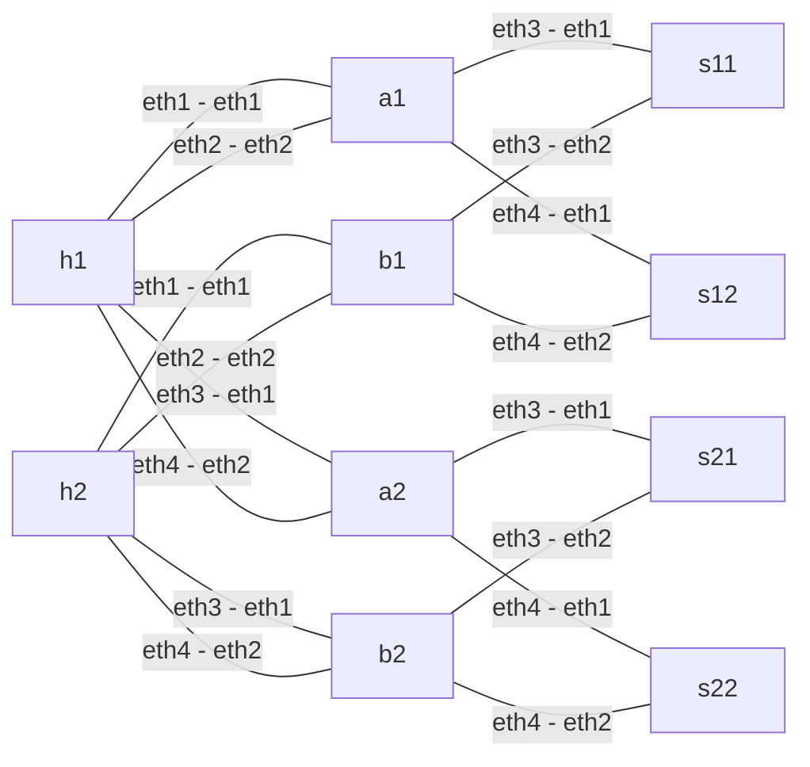

# multi-plane-multi-link

2 plane(s), 2 physical host link(s) per plane, 10 containers, 16 links, 8 source EVs.

Each plane has source leaf `aN`, destination leaf `bN`, and two spines `sN1`/`sN2`. Every leaf connects to both spines. The two hosts are shared across planes; the routers are not.



From the project root:

```sh
python3 lab.py deploy --profile multi-plane-multi-link
python3 lab.py test --profile multi-plane-multi-link
python3 lab.py destroy --profile multi-plane-multi-link
```

`mrc.clab.yml` is JSON (valid YAML) with relative bind mounts. Deployment through `lab.py` also installs the Linux SRv6 datapath; a bare `containerlab deploy` must be followed by `python3 lab.py configure --profile multi-plane-multi-link`.

See the root README for protocol limitations and how these study variants differ from the article's drawings. Results and captures are written under `results/` and are excluded from version control.
