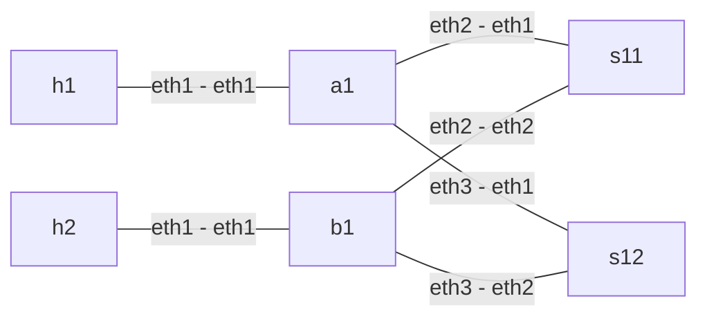

# single-plane-single-link

1 plane(s), 1 NIC port(s) per plane, 6 containers, 6 links, 2 distinct h1 -> h2 paths.

Each plane has leaf `aN` (h1 side), leaf `bN` (h2 side), and spines `sN1`/`sN2`. Hosts are shared across planes; switches are not.



Fabric `baseline`: FRR eBGP (timers 1/3) with ECMP over a 5-tuple hash. Hosts own `fc00:100::1` / `fc00:200::1` and use a static ECMP route across their NIC ports. Packets are plain IPv6/UDP; the EV is the UDP source port, and the path is whatever the hashes pick.

From the project root:

```sh
python3 lab.py deploy --profile single-plane-single-link
python3 lab.py test --profile single-plane-single-link
python3 lab.py experiment link-down --profile single-plane-single-link
python3 lab.py destroy --profile single-plane-single-link
```

`mrc.clab.yml` is JSON (valid YAML). A bare `containerlab deploy` must be followed by `python3 lab.py configure --profile single-plane-single-link`. Results are written under `results/` (not version controlled).
